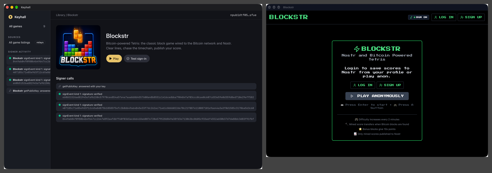

# Keyhall

A launcher and library for Nostr games. Every game you play opens in its own window under one key, and the key never enters a game.

Early work in progress: this is v0, desktop (macOS) first.



## What v0 does

- Lists games from relays: plain NIP-89 handler events (kind 31990) tagged `t=game` or `t=games`.
- Shows a sign-in badge from the listing's `auth` tags (worst case wins), a Nostr depth badge (`multiplayer`, `identity` or `none`) and when the game was last updated.
- Opens each web game in its own window with an injected `window.nostr` (`getPublicKey`, `signEvent`). Rust answers both. The first time a game asks to sign an event kind, the launcher window asks you to allow it; game windows can't answer that prompt.
- Keeps your key in the macOS keychain. Create one or import an nsec; it stays in the Rust process.

### Listing tags

```json
["auth", "nip07"]        // repeatable: nip07, nip46, nip55, session, guest, nsec, none
["depth", "multiplayer"] // or identity, none
["a", "30617:<pubkey>:<repo>", "<relay>", "repo"]
```

The depth badge starts as the listing declares it. Once you've played, the game window's record of which kinds the game publishes and subscribes to decides it, shown with a ✓. "Last updated" is the newest of the listing's `created_at`, the repo's last push (its NIP-34 state event, or GitHub) and its latest GitHub release.

### Isolation

Each game window gets a capability added at runtime, scoped to that window and the game's https origin, which allows only the three shim commands. Launcher commands are allowed for the `main` window only, so a game calling one gets `not allowed by ACL`.

## Develop

A pnpm workspace:

- `apps/desktop`: the Tauri 2 app, a React UI and the Rust host (`src-tauri`: keychain, signer, game windows).
- `packages/core`: listing parsing, badges, depth classification, the `window.nostr` shim, relay queries and the launcher's XState machine (key setup, library, game windows, signing approvals).
- `packages/ui`: shadcn components (Base UI, Phosphor icons) and the Tailwind theme.

```sh
pnpm install
pnpm dev                 # tauri dev
pnpm test                # vitest
pnpm check-types
pnpm lint && pnpm fmt:check
pnpm gate                # all of the above, cargo test and pnpm build (Keyhall.app)
```

Unsigned builds change their code signature on every rebuild, so macOS asks for keychain access again for a key a previous build stored.

## Next steps

- Keyhall picks: the official default list (NIP-51 kind 30267 under the project's key), the Sources sidebar, curator lists and unvetted listings behind a toggle.
- Curator verification: NIP-32 labels for sign-in and depth, and flagging key-shaped input fields in game windows.
- Presence (NIP-38 status, friends only by default via a circle key), friends and the friends list.
- Monthly budget: play-time metering in Rust (any running time counts) and month-end zaps over NWC.
- `nip44` in the shim, per-kind scopes from the listing's `k` tags, guest keys per game.
- Native games on desktop through a built-in NIP-46 bunker, Windows and Linux key stores, and mobile.
- Switching or removing the stored key.
