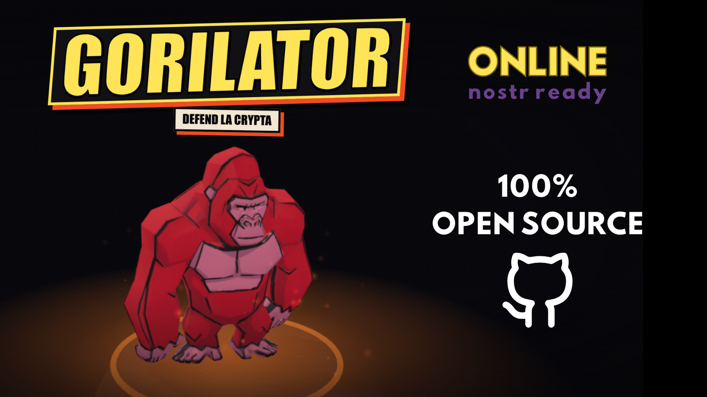

# Gorilator

A multiplayer isometric RPG about defending La Crypta with gorilla fury, loot and Nostr identity. Your character belongs to you. Play as a guest instantly, or log in with a NIP-07 extension or a remote signer.

