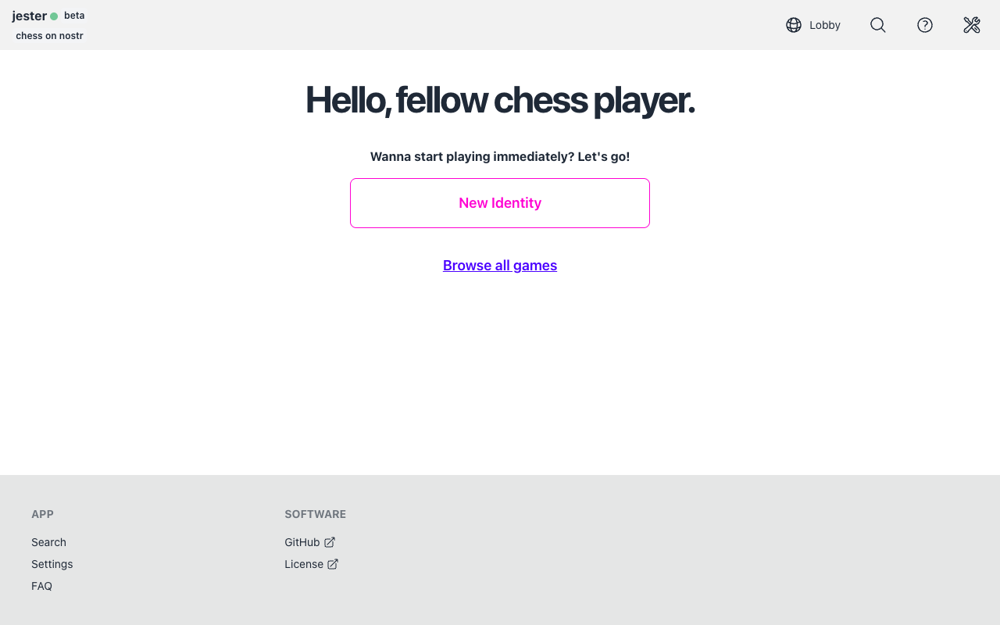

# Jester

Chess over Nostr. Create a new identity and start playing immediately, or browse the open games in the lobby. Jester doesn't support signer extensions yet: it makes a key for you or takes a pasted private key. You need an opponent, and the repository has been quiet since 2024.

