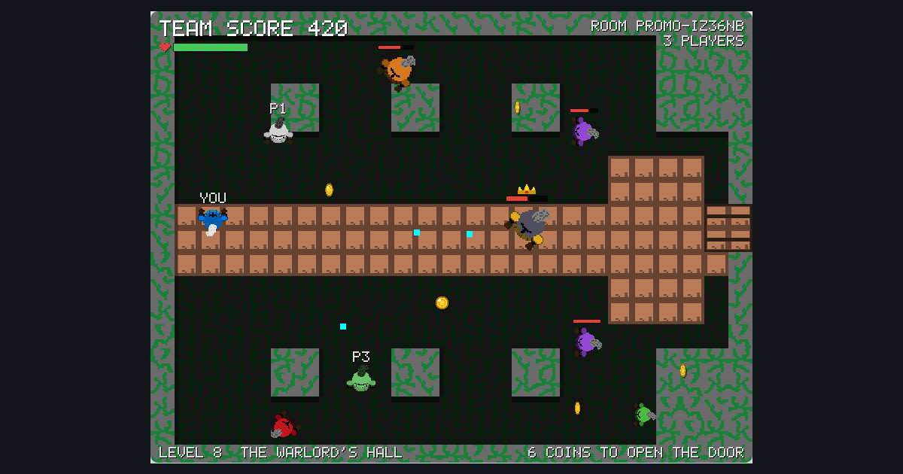

# Knight Survival

Collect coins, shoot the red knights and survive together. A free, open-source multiplayer survival shooter written in C++ that runs in the browser: no sign-up, no download. Nostr relays only connect the players in a room, and peers in a room can see your IP address.

