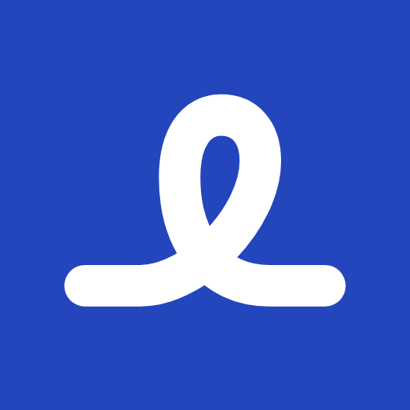
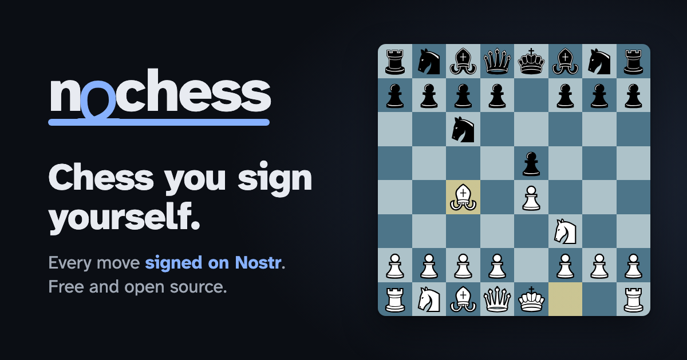

# Nochess

Chess you sign yourself. Free, open-source chess on Nostr: both players sign every move under their own key, so your games and your rating are yours to keep. No sign-up; your browser makes a key and the game starts. Paid bots ask for sats first.

