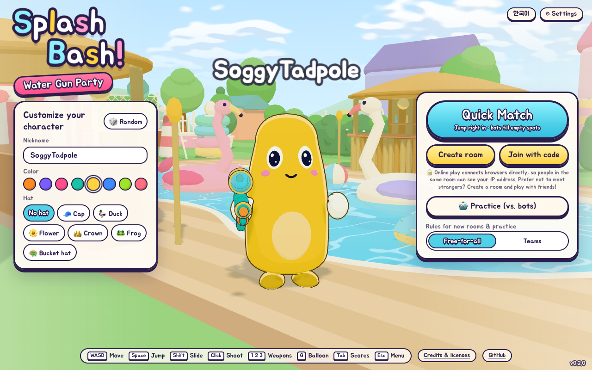

# Splash Bash!

A water-gun party shooter with cute bean characters in a backyard pool. Pick a nickname, colour and hat, then jump into a quick match (bots fill empty spots) or share a room code with friends. No install. Relays only carry the WebRTC signalling, so players in the same room can see your IP address.

