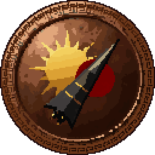
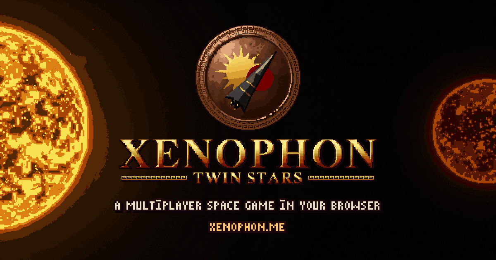

# Xenophon: Twin Stars

A multiplayer pixel-art space game that runs in a browser tab, with no server. Between a gold sun and a red one lie forty worlds; fly ore and fight raiders while the Nomarchy and the Anarchoi squadrons fight over them. Your pilot key is made in the browser, and “Restore pilot” takes a pasted nsec meant for the game's own key.

